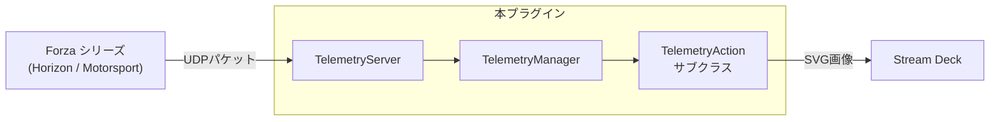

# アーキテクチャ概要

## ディレクトリ構造

```
.
├── .claude/
│   └── skills/
│       └── release/
│           └── SKILL.md                  # リリース用スキル
├── .github/
│   └── workflows/
│       ├── ci.yml                        # CI（lint、型チェック、テスト、ビルド、マニフェストの検証）
│       └── release.yml                   # GitHub Release の作成（タグの push で起動）
├── .vscode/
│   ├── launch.json                       # デバッグ設定（プラグインプロセスへのアタッチ）
│   └── settings.json                     # ワークスペース設定（JSONスキーマ、ESLint）
├── com.github.shiguruikai.streamdeck-forza-telemetry.sdPlugin/
│   ├── bin/                              # ビルド成果物の出力先（Git管理外）
│   │   └── THIRD_PARTY_LICENSES.txt      # サードパーティのライセンス表記（ビルド時に生成）
│   ├── imgs/                             # 画像リソース
│   │   ├── actions/                      # 各アクション用のアイコン画像（icon.svg と key.svg は同一データで配置）
│   │   └── plugin/                       # プラグインのアイコン画像
│   ├── layouts/                          # アクションのレイアウト定義
│   │   └── canvas-layout.json            # 全アクション共通のキャンバスレイアウト
│   ├── logs/                             # ログ出力先（Git管理外）
│   ├── ui/                               # 各アクションのProperty Inspector（設定画面）のUI定義
│   │   ├── common.css                    # 共通スタイルシート
│   │   ├── compass.html                  # コンパス
│   │   ├── components/                   # Web Component 群（src/ui/components のビルド成果物。Git管理外）
│   │   ├── g-force.html
│   │   ├── power.html
│   │   ├── race-info.html
│   │   ├── sdpi-components.js            # 公式のUIライブラリ
│   │   ├── speed-meter.html
│   │   ├── suspension-travel.html
│   │   ├── tire-temp.html
│   │   └── car-spec.html
│   └── manifest.json                     # プラグインの構成定義
├── docs/                                 # 設計・開発ドキュメント
│   ├── assets/                           # ドキュメント用画像・デモGIFアセット
│   │   └── demo.gif                      # README掲載用デモGIF
│   ├── forza-telemetry/                  # Forza テレメトリデータ仕様書
│   │   ├── fh6.md
│   │   └── fm8.md
│   ├── marketplace/                      # Marketplace 掲載・申請用ドキュメント
│   │   ├── listing.md                    # Marketplace 掲載用説明文
│   │   └── roadmap.md                    # Marketplace リリースロードマップ
│   ├── stream-deck/                      # Stream Deck プラグイン開発ナレッジベース
│   ├── architecture.md                   # アーキテクチャ概要
│   └── design-rules.md                   # UIデザインルール
├── src/                                  # ソースコード
│   ├── actions/                          # 各アクションの処理
│   │   ├── car-spec.ts                   # カースペック
│   │   ├── compass.ts                    # コンパス
│   │   ├── g-force.ts                    # Gフォースメーター
│   │   ├── power.ts                      # エンジン出力
│   │   ├── race-info.ts                  # レース情報
│   │   ├── speed-meter.ts                # 速度計
│   │   ├── suspension-travel.ts          # サスペンション
│   │   ├── telemetry-action.ts           # 共通ベースクラス
│   │   └── tire-temp.ts                  # タイヤ温度
│   ├── settings/                         # プラグイン設定関連
│   │   ├── index.ts
│   │   └── settings.ts                   # 設定のパース処理と適用処理
│   ├── shared/                           # UI・プラグイン共有モジュール（ブラウザや Node.js に依存しない純粋なTS）
│   │   ├── index.ts
│   │   └── settings.ts                   # 設定の型定義、デフォルト設定値
│   ├── telemetry/                        # Forzaテレメトリ関連
│   │   ├── manager.ts                    # テレメトリデータの管理
│   │   ├── parser.ts                     # UDPパケットのパーサー＆データ型定義
│   │   ├── server.ts                     # UDP受信サーバー
│   │   └── throttle.ts                   # 配信間隔に合わせたパケットの間引き判定
│   ├── types/                            # 型定義
│   │   └── sdpi.ts                       # SDPI (Stream Deck Property Inspector) 関連の型定義
│   ├── ui/                               # Property Inspector UI
│   │   ├── components/                   # Web Component群
│   │   │   └── global-settings.ts        # グローバル設定 (<global-settings>)
│   │   └── tsconfig.json                 # Property Inspector UI用TypeScript設定
│   ├── utils/                            # 共通ユーティリティ
│   │   ├── format.ts                     # 変換系の処理
│   │   ├── graphics/                     # SVG描画モジュール群
│   │   │   ├── car-spec.ts
│   │   │   ├── common.ts                 # 共通描画処理
│   │   │   ├── compass.ts
│   │   │   ├── g-force.ts
│   │   │   ├── power.ts
│   │   │   ├── race-info.ts
│   │   │   ├── speed-meter.ts
│   │   │   ├── suspension.ts
│   │   │   ├── tire-temp.ts
│   │   │   ├── wheels.ts                 # タイヤ・サスペンション用共通描画処理
│   │   │   └── index.ts
│   │   └── utils.ts                      # 汎用関数
│   ├── plugin.ts                         # プラグインのエントリポイント
│   └── tsconfig.json                     # プラグイン本体用TypeScript設定
├── tests/                                # テストコード
│   ├── format.test.ts                    # フォーマット処理の単体テスト
│   ├── graphics.test.ts                  # SVG描画の単体テスト
│   ├── parser.test.ts                    # パーサーの単体テスト
│   ├── settings.test.ts                  # グローバル設定の単体テスト
│   ├── simulate-telemetry.ts             # 擬似テレメトリ送信シミュレータ
│   ├── telemetry-action.test.ts          # TelemetryAction の単体テスト
│   ├── telemetry-manager.test.ts         # TelemetryManager の単体テスト
│   ├── telemetry-server.test.ts          # TelemetryServer の単体テスト
│   ├── throttle.test.ts                  # Throttle の単体テスト
│   └── tsconfig.json                     # テスト用TypeScript設定
├── tools/                                # 開発支援ツール
│   ├── gen-demo-gif.ps1                  # 録画動画からデモ用GIF (docs/assets/demo.gif) を生成するスクリプト
│   └── gen-marketplace-icon.ps1          # プラグインのアイコン（marketplace.svg）をPNG形式に変換するスクリプト
├── .editorconfig                         # EditorConfig設定ファイル
├── .gitattributes                        # Gitのファイル属性設定
├── .gitignore                            # Gitの除外設定
├── AGENTS.md                             # AIエージェント向けのガイド
├── CHANGELOG.md                          # 変更履歴
├── eslint.config.ts                      # ESLint設定ファイル
├── LICENSE                               # ライセンスファイル
├── package.json                          # プロジェクトの設定と依存関係
├── pnpm-lock.yaml                        # pnpmロックファイル
├── README.md                             # README.md
├── rollup.config.mjs                     # Rollupビルド設定
└── tsconfig.json                         # TypeScript設定（共通設定。src、src/ui、tests の各設定の親）
```

## データフロー



## 主要クラス・モジュール

### [TelemetryServer](../src/telemetry/server.ts)

- **役割**: `node:dgram` の `udp4` を用いてテレメトリデータを受信するUDPサーバー。受信した生パケットは、イベントとして上位（`TelemetryManager`）へ通知する。
- **エラー制御**: ソケットのバインドエラー（ポート競合など）や受信時エラーが発生した場合、自動でソケットをクローズし、エラーイベントを上位（TelemetryManager）へ通知する。

### [TelemetryManager](../src/telemetry/manager.ts)

- **役割**: 受信データのパースおよびアクションへの配信管理を行うシングルトンインスタンス。
  - 使用する際はインスタンスを直接インポートする。例：`import { telemetryManager } from '../telemetry/manager';`
- **データ解析と間引き**: `TelemetryServer` から生パケットを受信後、`IsRaceOn = 0`（メニュー中やポーズ中）のパケットは配信しない。それ以外は、[throttle.ts](../src/telemetry/throttle.ts) の `Throttle` でグローバル設定のFPS（10〜30 FPS、デフォルト15 FPS）に基づいた配信間隔に間引き、パース処理（[parser.ts](../src/telemetry/parser.ts)）でオブジェクト構造に変換してからイベントとして各アクションへブロードキャストする。
  - **対応フォーマット**:
    - Forza Horizon（324バイト）
    - Forza Motorsport 7 Dash形式（311バイト）
    - Forza Motorsport 8 Dash形式（331バイト）※Sled形式（232バイト）は未サポート。
- **最新データの保持**: 最後に配信したデータを1件保持し（`getLatestData()`）、全アクションで共有する。サーバーの停止、接続先の変更、タイムアウトで破棄する。
- **リソースの自動管理**: `data` イベントの購読数でアクティブなアクションの増減を監視し、ソケットの開閉を自動制御する。
  - 接続設定（ポート、IPアドレス）を受け取るまで、`TelemetryServer` は起動しない。不正な値で接続設定が破棄された場合も、新しい接続設定を受け取るまで起動しない（以前の接続先では再開しない）。
  - アクションが画面に表示されたとき、接続設定があれば `TelemetryServer` を自動起動。
  - すべてのアクションが画面から消えたとき、`TelemetryServer` を自動停止。
- **タイムアウト監視**: アクションが表示されている間、パケットが3秒間受信されなかった場合に、最新データを破棄してからタイムアウトイベントを発生させ、接続障害やゲーム未起動状態を上位（TelemetryAction）へ通知する。`IsRaceOn = 0` のパケットも受信として扱う。通信エラー（ポート競合など）でサーバーが停止した後や、接続設定が不正で受信を止めている間も監視を続け、通常の受信なしと同じく3秒後に通知する。

### [TelemetryAction](../src/actions/telemetry-action.ts)（アクションの共通ベースクラス）

- **ライフサイクル自動制御**: アクションの表示／非表示と連動して、テレメトリ受信の購読・購読解除を自動制御。
- **短押し・長押しのハンドリング**: キーおよびダイヤル操作の短押し（離した瞬間）と長押し（500ms経過時）のメソッド（`onShortPress`、`onLongPress`）を提供。サブクラスは、`onKeyDown` や `onKeyUp` を直接オーバーライドしてはいけない。
- **描画処理の例外制御**: 描画は `redraw()` を経由して実行し、描画処理（`onTelemetryData`）の例外を捕捉してログに記録する（未処理の Promise 拒否によるプラグインプロセスの終了を防ぐ）。サブクラスは、操作イベントなどから再描画する場合も `onTelemetryData` や独自の描画メソッドを直接呼び出さず、`redraw()` を使用すること。
- **画像の送信**: 画像の送信は `sendImage()` を使う（ダイヤルは `setFeedback`、キーは `setImage`）。前回と同じ画像は送信しない。`redraw()` が描画の入口、`sendImage()` が出口であり、サブクラスは `onTelemetryData` 内で `setImage` や `setFeedback` を直接呼び出さないこと。
- **最新データの参照**: 最新のテレメトリデータはアクションごとには持たず、`TelemetryManager` が保持する1件（`getLatestData()`）を全アクションで共有する。画面の切り替わりや設定変更時は、これを使って次の受信を待たずに再描画する。タイムアウト、サーバーの停止、接続先の変更で破棄されると、次のデータを受信するまではデータなし（`--` 表示）で描画される。
- **一斉再描画**: グローバル設定（フォント等）の変更時、登録済みのアクティブアクションに対して `refreshActiveActions()` を呼び出し、即時再描画を実行。
- **動的データソース**: `onSendToPlugin` で、Property Inspectorからのデータソース要求（`getFonts` イベント）をフックし、OSのローカルフォント一覧を動的に取得してUIへ配信する。
- **エラー・タイムアウトハンドリング**: TelemetryManagerからのエラーイベント（ポート競合など）を受信した際、現在アクティブなすべてのアクションに対してSDKの `showAlert()` を呼び出して警告を表示する。タイムアウトイベント（3秒間データ未受信）を受信した際は、すべてのアクションをデータなし（`--` 表示）で再描画してから、同様に警告を表示する。

### [Graphics モジュール](../src/utils/graphics/index.ts)

- **役割**: SVG描画処理およびコンポーネントを管理するユーティリティ群。
- **関数の命名規則**: 戻り値のデータ型と目的に応じて以下の規則に従って定義する。
  - **`generate<Feature>Image`**: Stream Deck の表示キャンバス（`setImage` / `setFeedback`）へ直接渡す SVG Data URI (`data:image/svg+xml,...`) を生成・返却する関数。
  - **`create<Feature>Svg`**: 別の描画関数内でパーツとして組み込んで利用する raw SVG 要素文字列（`<g>`, `<rect>`, `<circle>` 等）を構築・返却する関数。

## Property Inspector（設定画面）

Stream Deck公式のUIライブラリ [sdpi-components.js](../com.github.shiguruikai.streamdeck-forza-telemetry.sdPlugin/ui/sdpi-components.js) を使用し、設定の自動同期や動的なデータソースの取得に対応する。

- **グローバル設定 ([shared/settings.ts](../src/shared/settings.ts), [settings/settings.ts](../src/settings/settings.ts))**: プラグイン全体で共有される設定（接続ポート、IPアドレス、フォント、FPS、RPMカラー）。
  - デフォルト値と型定義は、UI・バックエンド共有モジュール（[shared/index.ts](../src/shared/index.ts)）で一元管理し、[plugin.ts](../src/plugin.ts) から `applyGlobalSettings()` を通じて一括適用される。
  - **適用のタイミング**:
    - FPS はすぐに反映する。
    - IPアドレスとポートは、入力途中の値で再接続しないよう、最後の変更から1秒後に適用する（起動時の最初の1回はすぐに適用）。不正な値の場合は受信を停止する。
- **ローカル設定**: SDKを介してアクション別に保存される設定（表示単位、レイアウト、車輪位置など）。

## CI・リリース

- **CI ([ci.yml](../.github/workflows/ci.yml))**: `main` ブランチへの push、プルリクエスト、リリースワークフローからの呼び出しで実行する。lint（警告でも失敗）、型チェック（`pnpm typecheck`）、単体テスト、ビルド、マニフェストの検証を行う。
- **リリース ([release.yml](../.github/workflows/release.yml))**: `vX.Y.Z` 形式のタグの push で起動する。CI を実行し、タグと `package.json`、`manifest.json`、`CHANGELOG.md` のバージョンを照合したうえで、`CHANGELOG.md` の該当バージョンの節を本文にして GitHub Release を作成する。手順の詳細は[リリース用スキル](../.claude/skills/release/SKILL.md)を参照。
